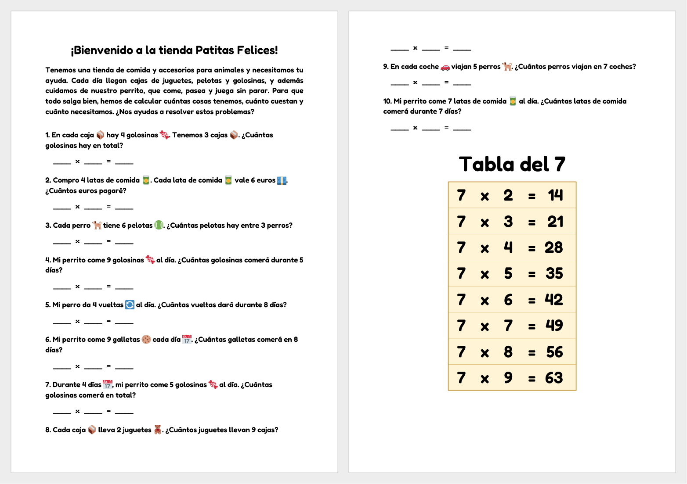

# Multiplicaciones · Patitas Felices

Genera hojas de ejercicios en PDF para practicar las tablas de multiplicar:
10 problemas con temática de perros y, al final, una tabla de multiplicar
resuelta para memorizar. Cada hoja es distinta, se puede enviar por correo y
también generar desde el navegador con un solo botón.



- Solo se usan las tablas del 2 al 9: el 0, el 1 y el 10 nunca aparecen.
- La tabla de referencia va rotando: no se repite ninguna hasta que han
  salido todas, y nunca sale la misma en dos hojas seguidas.

## Instalación

Hace falta Python 3.12 y [uv](https://docs.astral.sh/uv/).

```bash
git clone <URL-del-repositorio> multiplicaciones
cd multiplicaciones
uv venv env
uv pip install --python env/bin/python reportlab
```

Para enviar las hojas por correo, crea el fichero `.env` con los datos SMTP
(usuario, contraseña, remitente y destinatarios):

```bash
cp .env.ejemplo .env      # y rellénalo, o copia el .env de otro ordenador
```

El `.env` contiene la contraseña, así que **no se sube a git**: hay que
copiarlo a mano a cada ordenador.

## Uso

```bash
env/bin/python multiplicaciones.py                 # problemas con todas las tablas (2 a 9)
env/bin/python multiplicaciones.py 3 6 9           # problemas solo con las tablas 3, 6 y 9
env/bin/python multiplicaciones.py 3 6 9 -o x.pdf  # elegir el nombre del PDF
env/bin/python multiplicaciones.py -e a@x.com      # además, enviarlo por correo (-e se puede repetir)
env/bin/python multiplicaciones.py 3 6 -e          # -e sin dirección: a los DESTINATARIOS del .env
```

Sin `-o`, el PDF se guarda en la carpeta actual con un nombre como
`multiplicaciones_08-11_15h30_2026_012.pdf`.

### Página web

```bash
env/bin/python servidor.py          # http://localhost:8000  (-p PUERTO para cambiarlo)
```

Muestra un botón «Generar» que crea la hoja y la envía por correo a los
`DESTINATARIOS` del `.env`. Después de cada hoja hay una pequeña espera
antes de poder generar otra, para no mandar correos repetidos por error.

### Docker

```bash
docker compose up -d --build        # servidor web en el puerto 8000
```

El contenedor lee el `.env` al arrancar, así que la contraseña no queda
dentro de la imagen. Los PDF se guardan dentro del contenedor, en
`/app/pdfs`, y se pierden al recrearlo.

## Sincronizar entre ordenadores

El fichero `tablas_salidas.json` guarda qué tablas de referencia han salido
ya, y se sube a git a propósito para que la rotación sea la misma en todos
los ordenadores:

1. `git pull` antes de generar hojas.
2. `git commit` y `git push` después, para que los demás ordenadores lo
   reciban.

## Personalizar

- **Aspecto de la hoja** (fuente, tamaños, título, texto de introducción,
  colores de la tabla): constantes al principio de `generacion_pdf.py`.
- **Problemas** (objetos, situaciones y frases): `situaciones.py`. Para dar
  más variedad basta con añadir entradas.
- **Texto del correo**: `ASUNTO_EMAIL` y `TEXTO_EMAIL` en
  `multiplicaciones.py`.

La explicación de cada fichero y de cada función está en
**[AYUDA.md](AYUDA.md)**.

## Licencias de terceros

- Fuente **Fredoka** © The Fredoka Project Authors, con licencia
  [SIL Open Font License 1.1](fonts/OFL-Fredoka.txt).
- Emojis de **[Twemoji](https://github.com/jdecked/twemoji)** © Twitter, Inc.
  y otros colaboradores, con licencia
  [CC-BY 4.0](https://creativecommons.org/licenses/by/4.0/).
